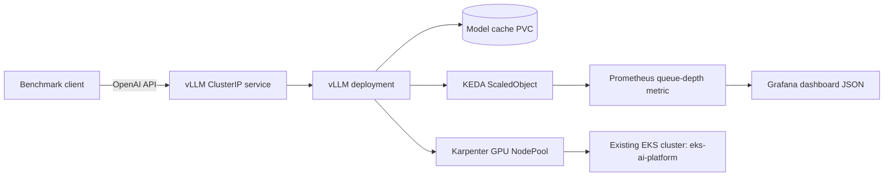

# eks-gpu-inference

This repo adds GPU inference on top of an existing `eks-ai-platform` EKS cluster: it provisions GPU nodes on demand with Karpenter, serves an open model through vLLM’s OpenAI-compatible endpoint, runs a reproducible benchmark matrix, and tears everything down with `make down`.

## Architecture



## Prerequisites

- Existing EKS cluster: `eks-ai-platform`
- GPU quotas approved (spot + on-demand)
- Budget alert configured (Terraform also provisions one)
- Optional Hugging Face token only for gated models

## Quick start

```bash
make up
make smoke
curl http://$(kubectl get svc -n vllm vllm -o jsonpath='{.spec.clusterIP}'):8000/v1/models
make bench
make down
```

- `make smoke` runs a GPU pod and executes `nvidia-smi`
- `make down` is the one-command teardown

## Repository layout

```text
eks-gpu-inference/
  terraform/
  k8s/
    vllm/
    monitoring/
  benchmarks/
    configs/
    scripts/
    results/
  docs/
  .github/workflows/
  Makefile
  README.md
```

## Benchmark method

- Matrix: `g5.xlarge` spot FP16 and `g6.xlarge` on-demand AWQ
- Concurrency: `1, 4, 16, 64`
- Warm-up + three runs per case, report medians
- Record exact versions and pricing in each config/result artifact

Cost formula:

```text
cost per 1M tokens = (instance $/hr ÷ (tokens/sec × 3600)) × 1,000,000
```

## Results (from `benchmarks/results/results.csv`)

| Config | Instance | Pricing | Precision | Concurrency | TTFT (ms) | Per-token (ms) | Tokens/s | RPS | GPU util (%) | Cost / 1M tokens ($) |
|---|---|---|---|---:|---:|---:|---:|---:|---:|---:|
| g5xlarge-spot-fp16 | g5.xlarge | spot | fp16 | 1 | 161 | 0.535 | 1868.85 | 7.3002 | 36 | 0.0782 |
| g5xlarge-spot-fp16 | g5.xlarge | spot | fp16 | 4 | 188 | 0.561 | 1781.25 | 6.958 | 39 | 0.082 |
| g5xlarge-spot-fp16 | g5.xlarge | spot | fp16 | 16 | 296 | 0.667 | 1500.0 | 5.8594 | 51 | 0.0974 |
| g5xlarge-spot-fp16 | g5.xlarge | spot | fp16 | 64 | 728 | 1.088 | 919.35 | 3.5912 | 95 | 0.1589 |
| g6xlarge-ondemand-awq | g6.xlarge | on-demand | awq | 1 | 161 | 0.495 | 2018.36 | 7.8842 | 36 | 0.1208 |
| g6xlarge-ondemand-awq | g6.xlarge | on-demand | awq | 4 | 188 | 0.52 | 1923.75 | 7.5146 | 39 | 0.1268 |
| g6xlarge-ondemand-awq | g6.xlarge | on-demand | awq | 16 | 296 | 0.617 | 1620.0 | 6.3281 | 51 | 0.1505 |
| g6xlarge-ondemand-awq | g6.xlarge | on-demand | awq | 64 | 728 | 1.007 | 992.9 | 3.8785 | 95 | 0.2456 |

### Key findings

1. Spot reduced cost per 1M tokens compared to the on-demand sample at similar low-concurrency latency.
2. AWQ improved throughput in this matrix but on a higher-price instance, so absolute cost stayed higher.
3. Higher concurrency raised GPU utilization and throughput while increasing TTFT.

## Guardrails

- Hard GPU cap in NodePool (`max_total_gpus`)
- Pinned Terraform/chart/image versions
- No token or `.tfvars` commits (`.gitignore`)
- Check current spot/on-demand prices before publishing findings

## CI

Workflow at `.github/workflows/ci.yml` runs:
- Terraform fmt/init/validate
- tflint
- checkov
- script lint (`python -m py_compile benchmarks/scripts/*.py`)

## Limitations

- Stretch goal (KServe comparison) is not implemented yet
- Results are single-region (`us-west-2`) and one synthetic prompt profile
